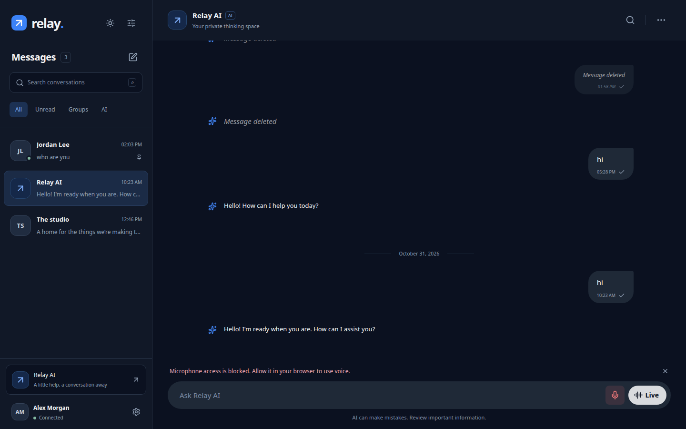
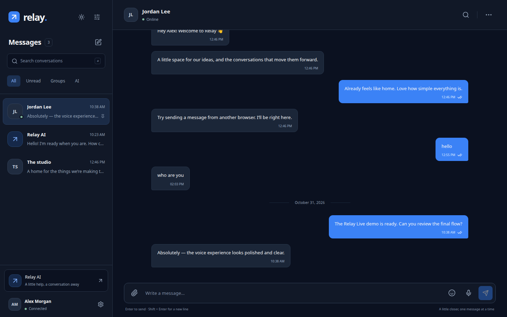
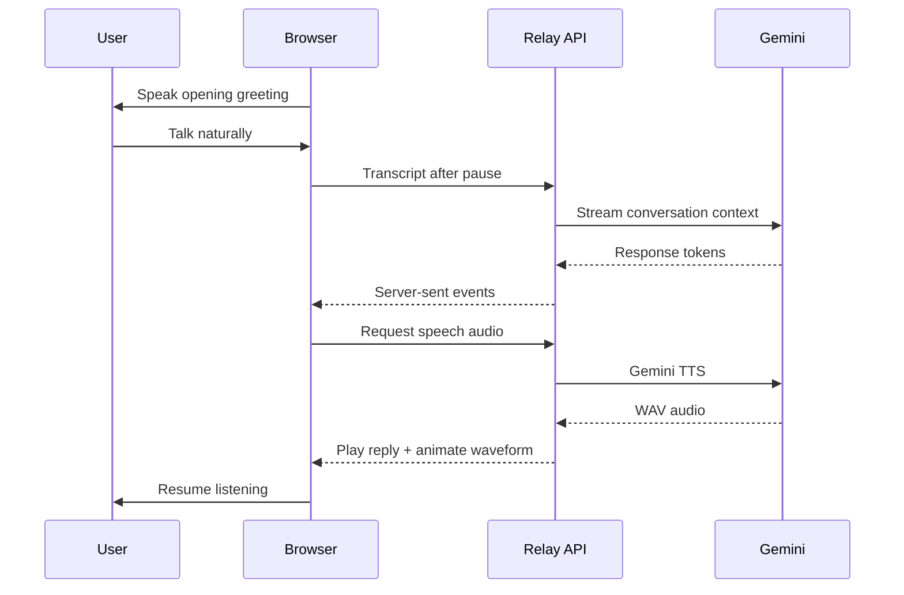

# Relay

**Private messaging and natural AI voice conversations in one focused workspace.**

Relay combines a real-time messenger with Relay Live, a hands-free Gemini voice
experience. Start Live and Relay opens a persistent Gemini Live session that
streams microphone and response audio simultaneously, including natural
barge-in while the assistant is speaking.



[Watch the 10-second product demo](docs/demo/relay-demo.webm)

## AI voice chat comes first

Relay Live is built as a continuous conversation rather than a voice button
attached to a text box.

- **AI speaks first.** Relay opens with a friendly spoken greeting.
- **Full-duplex audio.** Microphone PCM and Gemini audio flow continuously over
  one authenticated WebSocket session.
- **Streaming responses.** Native 24 kHz speech arrives and plays immediately.
- **Natural interruption.** Speaking over Relay cancels queued response audio.
- **Responsive waveform.** Microphone volume drives the listening visualization;
  animated waves show thinking and speaking states.
- **Interruptible.** Tap the waveform while Relay is speaking to jump in.
- **Hold and resume.** Pause the conversation without leaving Live mode.
- **Private context.** The AI receives only the current Relay AI conversation.
  API keys remain on the server.

Text chat uses Gemini's OpenAI-compatible endpoint. Relay Live uses Gemini Live
with the Kore voice; the existing transcription and TTS endpoints remain as a
fallback when real-time audio cannot initialize.

## Real conversations between people

Relay is also a complete direct and group messaging experience. PostgreSQL is
the source of truth, while Redis and WebSockets deliver live updates.

- Direct messages and owner-managed group chats
- Optimistic sending with retry and idempotent persistence
- Replies, edits, tombstone deletion and six reactions
- Typing, online presence, unread counts and delivery/read receipts
- Private image, PDF and text attachments up to 10 MB
- Conversation search, pinning, muting and shared-file details
- Responsive desktop and mobile layouts with keyboard accessibility



## Run everything from one terminal

Requirements: Docker Desktop or Docker Engine, Docker Compose v2, Node.js 24,
Python 3.12+, and [uv](https://docs.astral.sh/uv/).

```bash
cp .env.example .env
```

Add a Gemini API key to the single root environment file:

```env
AI_API_KEY=your-gemini-api-key
```

Then start the entire stack:

```bash
npm run dev
```

This command starts Docker Desktop when necessary, waits for PostgreSQL, Redis
and private object storage, runs migrations, and launches the API, worker and
frontend in the same terminal.

- App: <http://localhost:3000>
- API docs: <http://localhost:8000/docs>
- Storage console: <http://localhost:9001>

Development accounts:

| User | Password |
| --- | --- |
| `alex` | `Relay-demo-2026!` |
| `jordan` | `Relay-demo-2026!` |

For a temporary no-Docker demo with mocked AI, use `npm run dev:lite`.

## How a Live turn works



## Architecture

| Layer | Technology | Responsibility |
| --- | --- | --- |
| Web | Next.js 16, React 19, strict TypeScript | Messaging UI, Live mode, speech input and audio playback |
| API | FastAPI, Pydantic, SQLAlchemy | Auth, messaging contracts, AI streaming and speech generation |
| Data | PostgreSQL, Alembic | Users, conversations, messages, receipts and AI usage |
| Realtime | Redis, native WebSockets | Events, presence, typing, rate limits and AI locks |
| Files | RustFS/S3-compatible storage | Private uploads and authorized downloads |
| AI | Gemini chat completions + Gemini TTS | Streamed responses and natural spoken replies |

The backend stores server-side sessions in HttpOnly cookies, validates CSRF and
request origins, hashes passwords with Argon2, rate-limits authentication and AI
requests, and never exposes the provider key to the frontend.

Relay is **not end-to-end encrypted**. The server can read message content. The
current release also does not include person-to-person calls, push notifications,
password recovery or MFA.

## Development and verification

```bash
cd backend
uv run pytest -q

cd ../frontend
npm run typecheck
npm test
npm run build
npm run test:e2e
```

Recreate the README media while the local stack is running:

```bash
cd frontend
npx playwright install chromium ffmpeg
node scripts/capture-demo.mjs
```

The capture script uses isolated Alex and Jordan sessions, records Relay Live,
and verifies real-time message delivery before producing the screenshots and
WebM demo.

## Repository guide

- [`frontend/`](frontend/) — application UI, voice engine and browser tests
- [`backend/app/`](backend/app/) — API, AI adapter, worker and data models
- [`infra/`](infra/) — local Compose infrastructure
- [`docs/ARCHITECTURE.md`](docs/ARCHITECTURE.md) — system design and tradeoffs
- [`docs/API.md`](docs/API.md) — HTTP and WebSocket contracts
- [`docs/DEPLOYMENT.md`](docs/DEPLOYMENT.md) — production deployment guidance
- [`docs/STATUS.md`](docs/STATUS.md) — implemented features and known limits
- [`docs/VERIFICATION.md`](docs/VERIFICATION.md) — validation record

Dependency resolution is committed in `frontend/package-lock.json` and
`backend/uv.lock` for reproducible installs.
