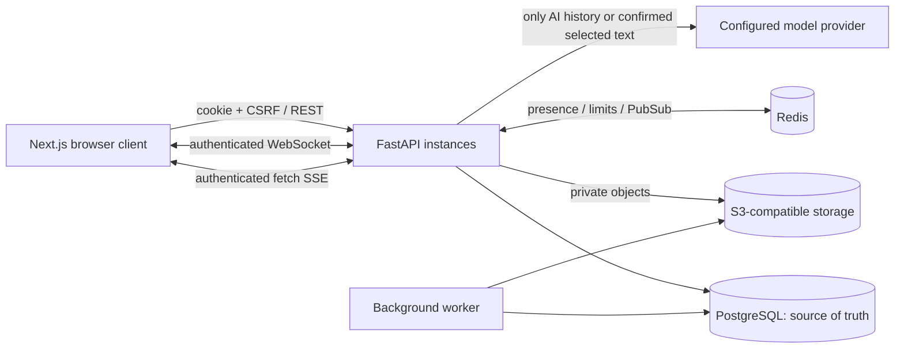

# Architecture

A single backend application serves REST, WebSockets and AI streams. The worker uses the same model and configuration code. This is a monorepo, not a microservice architecture.

## Durable state

Users have Argon2 password hashes. Session cookies contain random secrets; only SHA-256 token hashes, CSRF tokens, user IDs and expiry timestamps are stored in the database. Sessions can be individually or globally revoked. UTC timestamps are stored with timezone-aware columns; the API serializes ISO timestamps.

Conversations have normalized memberships with owner/admin/member roles. Read and delivery cursors belong to each membership; notification and pin preferences are separate per-user rows. Messages have a monotonically increasing database sequence, UUID identity, client UUID, sender, body and optional reply relationship. History is indexed by `(conversation_id, seq)`. The unique `(conversation_id, sender_id, client_id)` constraint prevents duplicate ordinary messages. Sends serialize on the conversation row before assigning message sequences so transaction commit order cannot leave a history cursor skipping an in-flight earlier send.

AI uses the **same message model**: an assistant message has a null sender and can exist only in a private `ai` conversation. Shared rendering, history, timestamps and deletion semantics stay consistent. Generations separately track status, token usage (when the provider supplies it), and latency. AI endpoints verify the conversation kind and owner membership. No tool execution or automatic access to ordinary chats exists.

## Live delivery and recovery

The HTTP response is the durable send acknowledgement. The API commits before publishing a versioned event. Every backend instance subscribes to Redis; membership and session validity are rechecked before forwarding an event. Redis Pub/Sub is ephemeral. A failed publication does not roll back a saved message.

The browser deduplicates event IDs, invalidates query caches, and fetches authoritative data. It reconnects with capped exponential backoff and jitter, refetches on reconnect/window focus, and polls every 15 seconds as a reconciliation fallback. Histories have conversation-specific cache keys. Optimistic records merge by sender/client UUID and retain failed sends for explicit retry. Cursor history supports both `before` (older pages) and `after` (missed newer messages); deleted records remain tombstones so cursors stay stable.

A single check means the server committed the message. A delivered cursor means an authenticated browser fetched and acknowledged messages through that sequence. A read cursor means the active conversation was loaded in a visible document. These are device observations, not proof that a human read the text. For groups, double checks aggregate all current other members. Multi-tab receipts update monotonically under a database row lock.

Presence uses a Redis lease renewed while an authenticated socket is alive. It expires after 45 seconds, accommodating multiple tabs without one closing tab forcing the user offline. Privacy settings hide online/last-seen from API consumers. Typing expires after five seconds both in Redis and in the client. Presence shown in conversation lists reconciles on polling.

## Files and deletion

Uploads accept only PNG/JPEG/WebP/PDF/UTF-8 text, validate size and signatures, and use server-generated UUID keys. Images have a pixel-count limit. Files remain pending until a background worker validates them again. The database acts as the durable processing queue; `FOR UPDATE SKIP LOCKED` permits multiple workers. Uploaded HTML is rejected; filenames are rendered as text. Downloads check membership and attachment state and use `attachment`, `nosniff`, no-cache and restrictive CSP headers. Pending unbound files are visible only to their uploader.

Message deletion replaces the body with an empty tombstone and schedules attached objects for deletion. Replies retain their target ID and render “Deleted message.” Deleted messages do not count as unread. AI clear-history erases all prompt/response bodies but retains tombstone positions and usage audit rows. Abandoned uploads with metadata are deleted after 24 hours. See the operational limitations for crash-orphan cleanup and malware scanning.

## AI boundaries

A per-user Redis lease prevents concurrent generations; a database count limits daily generation attempts in UTC. Failed and cancelled attempts count toward the quota to prevent retry abuse. Context is capped to 40 recent messages and a character budget; output is capped to 2,048 provider tokens. A whole-request timeout bounds provider stalls. Incomplete responses are never stored as completed assistant messages. Provider output is treated as text/Markdown, with no raw HTML, remote images, or executable tools.

Selected-message summaries require a client preview and explicit confirmation. The server rechecks access to each selected message and verifies that its body matches the preview snapshot, rejecting changed/deleted messages. Only selected bodies enter the AI prompt. The model is instructed to treat them as untrusted quoted data.
